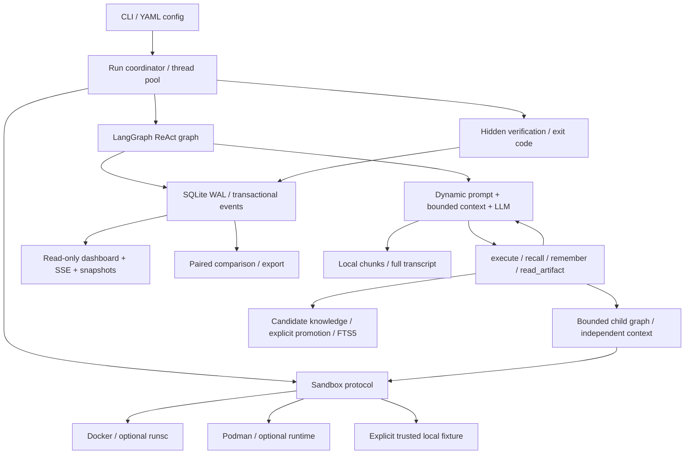

# 架构与实施决策

## 执行与判分

LangGraph 提供可编译的状态图和子图执行，本项目在图节点中实现受控 ReAct 工具循环。相较于替换模型 SDK，显式节点使预算、压缩、检索与 prompt 选择集中在模型调用边界，便于测试和审计。没有以框架名字宣称模型能力排名，也没有依赖托管 LangSmith 服务。

参考：[LangGraph workflows/agents](https://docs.langchain.com/oss/python/langgraph/workflows-agents)、[StateGraph compile](https://reference.langchain.com/python/langgraph/graph/state/StateGraph/compile)、[LangChain model interface](https://docs.langchain.com/oss/python/langchain/models)、[gVisor Docker runtime](https://gvisor.dev/docs/user_guide/quick_start/docker/)。

每个尝试独占镜像和容器；构建上下文只包含该任务 Dockerfile，不挂载项目、宿主目录或 Docker socket，不向沙盒注入模型密钥。默认断开运行时外网、限制 CPU / RAM / PID、禁止提权并裁减 capabilities。保留少量包管理和服务配置所需 capabilities。容器 root 仍是容器 root，Dockerfile 构建器属于更高信任边界。新后端实现 `start/execute/close` 即可接入；本版未实现 Firecracker、远程 VM、Kubernetes 或云沙盒后端。

执行使用参数数组调用 runtime CLI；模型命令仅作为容器内 `bash -lc` 的参数。容器内 GNU timeout 限制命令组；超时、异常取消或输出超量后停止整个容器，避免后台后代继续执行。执行输出上限约 8 MB，轮询检测可能有短暂超量；更早的输出 offload 用于控制模型上下文。超时后容器不可继续使用，可能导致 verifier 无法运行并被标记为 error。cleanup 失败单独记录，不修改已发生的判分。强制杀死 runner 时使用持久化 sandbox.json 定向清理。

Verifier 在 agent 结束后由协调器执行，脚本和输出均不传回 agent；以退出码 0 且无超时 / 截断判成功。模型自行宣称完成、stdout 含 True、stderr 非空都不决定判分。任务获得 root shell 时可以影响同容器中的 verifier 依赖；本版没有外置可信 grader 或抗恶意判分环境篡改保证。

## 协作与预算

`delegate` 是真实子图模型循环，拥有独立消息列表。子 agent 只接收委派目标、同领域检索参考与共享工作笔记，不复制主 agent 全部上下文。主 agent 等待子图完成后收到报告；共享文件系统，因此同一任务内命令顺序执行。跨任务通过线程池并行。

子图无委派工具，深度固定为一层；委派总次数、子图轮数和全局模型调用数均有界。主 agent、子 agent、LLM 摘要共享 `Budget`。工具 schema、system prompt、检索内容都纳入输入预算估计；输出上限受剩余预算约束。已返回 provider usage 优先，缺失时按字节估算并明确标记。远端失败重试可能没有 usage，会记录 usage_unknown 事件及未知调用计数，因此账单仍应以 provider 为准。SDK 隐式重试关闭，由 harness 在重试前重新检查预算，每次请求及重试均计入 step；请求 timeout 受剩余时间约束，底层连接关闭或服务端处理仍可能晚于客户端时限。

## 上下文策略

1. 每条工具结果先完整落到 artifact 文件；超出 `output_chars` 时仅将首尾片段与 ref/chunk 索引送入模型。
2. `read_artifact(ref, chunk)` 只接受当前尝试内生成的 32 位引用，不能读取任意宿主路径。chunk 按 Unicode 字符分割，索引从 0 开始。
3. 模型调用前，输入预算按序列化 UTF-8 字节保守估计，属于 tokenizer 无关的上界近似，不等于 provider token 数。配置名称为 token 预算，实际可容纳文本往往少于模型宣称的窗口。
4. 保留原始任务和最近 N 个完整工具轮次。裁剪单位是 AI 工具调用及其全部 ToolMessage 返回，避免孤立 tool_call_id。
5. 被裁剪历史完整归档。默认抽取首尾内容作为有界摘要；启用 `llm_summary` 后按 chunk 向模型请求保留目标、决策、文件路径、失败、待办的摘要，并将这些调用纳入全局预算。
6. 压缩后仍超限，进一步减少保留轮次、缩短摘要；若任务加最近一个完整轮次仍超限，明确终止并记录错误，不静默丢失工具返回。
7. 所有原始模型消息和工具返回顺序追加到 transcript.jsonl。摘要、输出和记忆作为不可信参考内容注入；这些提示性约束不能构成 prompt injection 的形式化防御。

本版的短期上下文、工作笔记随尝试存在。崩溃恢复会保留归档并在新环境重新执行，不使用 LangGraph checkpoint 恢复已经失去容器副作用的图状态。

## 记忆与 Prompt 生命周期

工作记忆 → 长期提案 / 成功轨迹蒸馏 → 审阅 → 校验来源已通过 → 导出 Markdown 与数据库晋升 → 检索。

FTS5 使用转义词项和绑定 SQL 参数，按 collection / domain / source UUID / frozen ID 集过滤，再按 BM25 排序。检索 ID 写入事件。已晋升记录不原地编辑，因此冻结 ID 同时冻结内容；新的经验必须创建新候选。`frozen` 支持可重复比较，`continual` 支持运行间学习实验，`off` 支持不启用跨任务记忆的基线。基础规则、profile、自更新附加 prompt 依次组合；热更新的实际文本和 hash 均保存。

提案不能自动晋升，避免把失败轨迹或本轮答案直接写成下一题的 SOP。成功仍不保证通用性；近重复任务、题库污染和手工编写的泄漏内容必须由实验者在训练 / 测试分离时控制。没有声称 FTS5 是语义向量检索；后续可替换搜索实现而保持 lifecycle 和 provenance 不变。

## 监控与指标

SQLite 每次事件插入与对应计数更新在同一事务提交；每个线程用独立连接、WAL、busy timeout，禁止 YAML 追加作为在线状态源。SSE 用单调 seq 和 Last-Event-ID 续传，浏览器另以两秒快照校准；中央心跳两秒更新，超过 30 秒可识别 stale。浏览器断开不影响运行。SQLite 应位于本机文件系统；不支持多台机器共享 NFS 数据库的分布式协调。

状态包括 pending / running / passed / failed / error / cancelled / interrupted。failed 是已完成但验证不通过；error 是运行或模型基础设施错误；cancelled / interrupted 不进入完成率分母，比较时明确展示未完成数量。passed_tasks 是至少一个尝试通过的不同 UUID 数，仅用于进度；attempt pass rate 和 macro pass@1 独立计算。

对比按 task_id/repetition 求交，并只在各运行均有最终结果的交集上计算 paired metrics。UUID 相同不代表任务内容相同，因此保留数据指纹差异提示。历史结果无法恢复 token 输入输出拆分、真实环境或缺失的 prompt 来源。

## 当前验证边界

本机自动化测试验证真实 LangGraph 执行、本地 shell、真实 provider SDK 的 HTTP mock 序列化、并发 SQLite、超时进程组、上下文消息合法性、记忆冻结、prompt 更新和恢复。容器命令契约另有 mock 测试，真实 Docker smoke 纳入 Linux CI；未宣称本机完成 Docker / Podman / gVisor 实测或付费模型全数据集重跑。gVisor、rootless Podman、服务依赖与数据集中外部 URL 的可用性需要部署环境验证。
